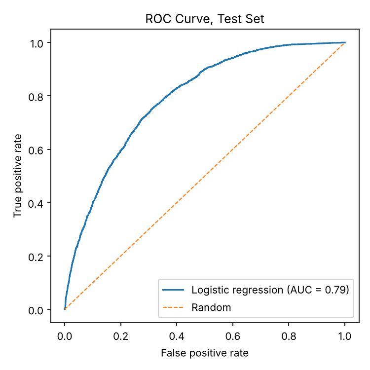
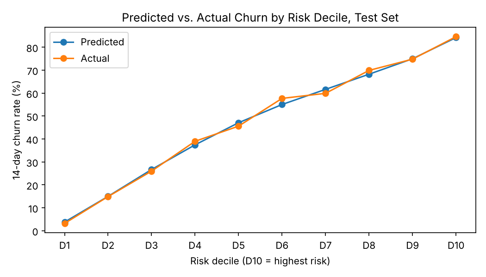

# Music-Streaming Retention & Churn Analysis

End-to-end retention analysis for a simulated music-streaming platform (50,000 users, 1.49M events): building user-level metrics from raw event logs in SQL, finding which users and channels drive churn, predicting 14-day churn, and designing an A/B test to lift paid conversion.

**Tools:** SQL (DuckDB), Python (pandas, scikit-learn, SciPy, Matplotlib)

## Key Findings

| Finding | Evidence |
|---|---|
| Rebuilt 21 user-level engagement, ad, and subscription metrics from **1,486,999 events** (1.07M listening, 310K ad, 104K subscription) for **50,000 users**. 20 reconcile 100% with the reference feature table; the 21st exposed a future-data leak (below) | `sql/01_user_metrics.sql`, `rpt_event_volume.csv`, `rpt_metric_reconciliation.csv` |
| **Inactive users churned at 6.7x the rate of highly active users** (77.2% vs. 11.6%). Users with no playlist adds churned at 56.3% vs. 6.3% for users with 3–5, supporting a playlist-led onboarding strategy | `sql/02_engagement_churn.sql`, `rpt_activity_churn_ratio.csv`, `rpt_churn_by_playlist_adds.csv` |
| **Paid Social users churned at 60.2% vs. 36.1% for Referral.** Casual-free users were 35.8% of users but 48.9% of churners | `sql/03_churn_segments.sql`, `rpt_churn_by_channel.csv`, `rpt_churn_by_lifecycle.csv` |
| Logistic regression reached **0.79 ROC-AUC** on an untouched test set. The **top-20% risk tier churned at 79.7%, 1.68x the 47.6% baseline**, capturing a third of all churners | `src/churn_model.py`, `outputs/model/topk_lift.csv` |
| Found and removed a **future-data leak**: the reference table's trial flag counted 489 users whose first trial began after the snapshot | `rpt_leakage_audit.csv`, `outputs/model/leakage_sensitivity.csv` |
| **Paywall-origin trials converted 3.7 points higher at 30 days** than email-origin trials (57.3% vs. 53.7%, p = 0.05), not explained by trial-length mix. This motivated an A/B test of paywall messaging | `sql/04_trial_conversion.sql`, `src/ab_test_design.py` |

<p>
  
  
</p>

## Repository Structure

```
├── sql/
│   ├── 00_staging.sql            # load raw CSVs, standardize names and types
│   ├── 01_user_metrics.sql       # events -> one row per user; QA, reconciliation, leakage audit
│   ├── 02_engagement_churn.sql   # churn by activity level and playlist behavior
│   ├── 03_churn_segments.sql     # churn by channel, plan, lifecycle; over-representation
│   └── 04_trial_conversion.sql   # 30-day trial-to-paid conversion by touchpoint
├── src/
│   ├── run_sql.py                # runs the SQL pipeline, exports reports to outputs/sql/
│   ├── churn_model.py            # logistic regression + random forest benchmark, Top-K lift
│   └── ab_test_design.py         # significance of observed gap, power analysis, SRM check
├── notebooks/                    # exploratory analysis
├── outputs/                      # generated reports, model results, figures
└── data/                         # raw CSVs (not committed; see data/README.md)
```

## How to Run

```bash
pip install -r requirements.txt
python src/run_sql.py          # SQL pipeline -> outputs/sql/
python src/churn_model.py      # model training and evaluation -> outputs/model/, outputs/figures/
python src/ab_test_design.py   # A/B test sizing -> outputs/ab_test/
```

## Methodology

**User-level metrics and leakage control.** Raw events are rolled up to one row per user at an April 1, 2026 snapshot. Every feature uses only events strictly before the snapshot, and the churn label covers the 14 days after it. Rebuilding the metrics also surfaced two data issues:

- *Window definition.* A strict 30-day look-back matched the reference feature table for only about 80% of users. The reference "30-day" features actually span 31 days (all of March); after matching that window, all 20 behavioral metrics reconcile for 100% of users.
- *Future-data leak.* The reference `trial_used_before_snapshot` flag was set for anyone who ever started a trial, including 489 users whose first trial started after the snapshot. The model uses the rebuilt, pre-snapshot-only flag instead. Retraining with the original flag gives the same test AUC (0.792), so the leak did not inflate the reported results, but the fix keeps the feature honest for production.

The model script also refuses to train if any prediction-window or outcome column (future activity, renewals, revenue, conversion) appears in the feature list.

**Churn rate vs. churn contribution.** A segment can have an extreme churn rate but be too small to matter. Each segment is reported with its churn rate and its over-representation (share of churners ÷ share of users), so prioritization follows where churn actually concentrates.

**Model selection.** Logistic regression (0.792 test AUC) and a random forest (0.789) performed almost identically, so logistic regression was kept for interpretability and easier monitoring. Because retention teams have limited outreach capacity, the model is evaluated on Top-K lift rather than a single classification threshold. Predicted and actual churn track closely across all ten risk deciles.

**Trial conversion.** Each user's first trial is assigned to the touchpoint it started from and counted as converted if a paid subscription starts within 30 days. Trials that started less than 30 days before the end of the data are excluded, since they have not had a full window to convert. Paywall and email trials had a similar share of 30-day trials (30% vs. 29%), so trial length does not explain the gap.

**A/B test design: paywall messaging.**

The power analysis changed the design. Paywall-origin trials alone arrive at about 25 per week, enough to detect only a 15-point lift in a 12-week test. Widening eligibility to all trial starters (about 170 per week) brings the detectable lift down to about 4 points over 26 weeks.

| Element | Design |
|---|---|
| Hypothesis | Value-based paywall messaging (the user's own listening, saved playlists, and what they lose at trial end) lifts 30-day trial-to-paid conversion vs. the current price-led copy |
| Unit | User, randomized 50/50 at trial start |
| Eligible users | All users starting a first trial, any touchpoint |
| Primary metric | 30-day trial-to-paid conversion (baseline 54%) |
| Secondary metrics | Paid retention at first renewal, 14-day listening retention |
| Guardrails | Refund rate, early cancellation, support contacts |
| Sample size | 2,417 users per arm for a 4-point lift (α = 0.05, 80% power): about 28 weeks of enrollment plus a 30-day conversion window |
| Quality checks | Sample-ratio-mismatch test, exposure logging |
| Decision rule | Ship if the 95% CI for the lift excludes zero and guardrails hold |

The paywall-vs-email gap is observational and only borderline significant: users who start trials from the paywall chose to, so the gap mixes user intent with the surface itself. The experiment isolates the causal effect of messaging.

## Limitations

- The data has a single snapshot, so validation is a random holdout rather than an out-of-time backtest. Production use would need multiple snapshots and drift monitoring.
- Segment comparisons and model coefficients are associations, not causal effects.
- Test duration reflects this dataset's 50K-user scale; a production platform's traffic would shorten it substantially.
- The dataset is simulated and does not represent any real company's users.
